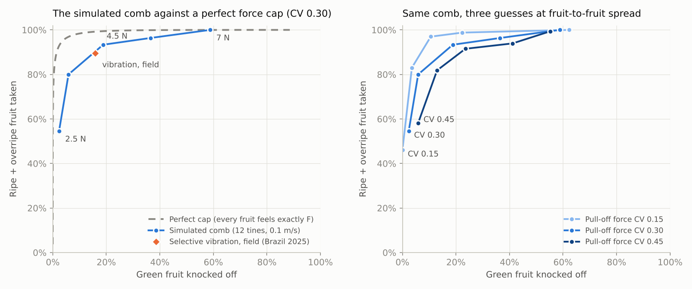
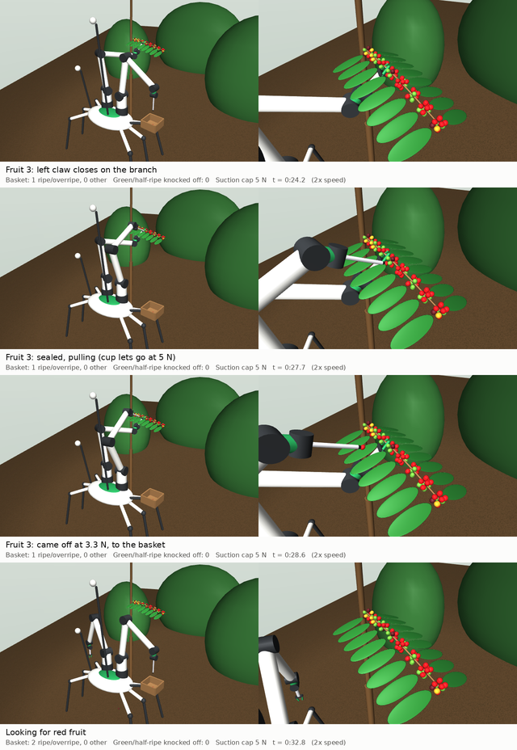
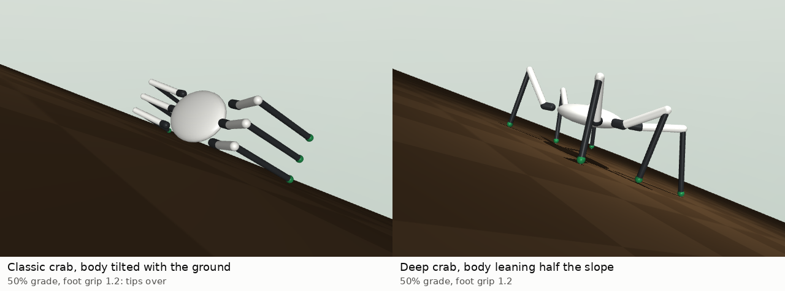
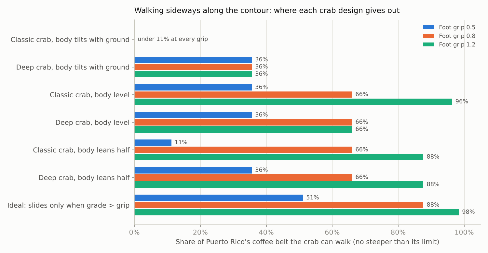
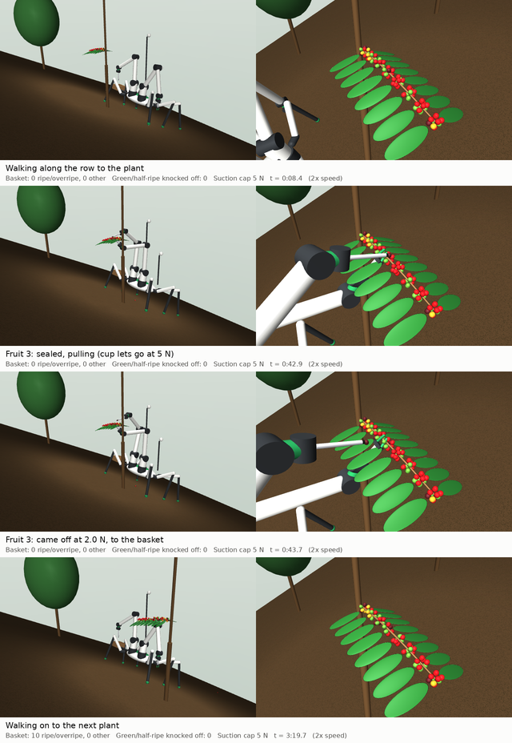
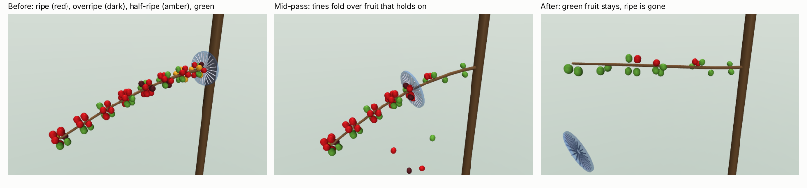

# Coffee picker: selective harvesting on Puerto Rico slopes

A simulation-first study of whether a robot can pick ripe coffee selectively,
fast enough to matter, on steep mountain farms. It was started with PROCAFE.
It lives in this repository for now and can move to its own repository with
its history.

## The question this milestone answers

Picking one fruit at a time is slow. A selective picker in Colombia takes
82.6 kg of cherry a day (Cenicafé). That is about 1.9 fruit per second, at
1.53 g per fruit. The best published fruit-picking arm takes 7.5 s per fruit,
so it would take **14 arms to match one person** working the same hours.
(One-at-a-time picking is still worth seeing working; see
[Single-fruit picking](#single-fruit-picking-two-claws-and-a-suction-cup).)

The opening is a property of the fruit itself. Ripe cherries come off at about
3.3 N; green ones hold until about 8.8 N (Sampaio 2000, five arabica
varieties). A tool that sweeps a whole branch while capping the push each
fruit feels between those two forces could take ripe fruit by the dozen and
leave green fruit on the plant.

**Milestone 1:** does that hold up once contact mechanics are real? Real
contact means tines landing unevenly, fruit pushing fruit, peduncles bending,
and the branch flexing.

## What the simulation says (240 runs)



Best setting at the middle assumption (a 3.5 N per-fruit rating, 12 tines,
0.1 m/s, pull-off spread CV 0.30), per pass:

- takes **80%** of ripe and overripe fruit;
- knocks off **6%** of green fruit and 34% of half-ripe fruit;
- **89%** of what it collects is ripe or overripe.

For scale, the selective shaker tested in Puerto Rico (Brudden DSC-18) worked
faster, at 26.9 kg/h, but 25% of what it took was unripe. That comparison sets
a field result against a simulation, which flatters the simulation.

1. **The principle holds; the comb is not yet good at it.** A perfect force cap
   would take 97% of ripe fruit at the same 6% green loss. The comb takes 80%,
   and its curve runs right past the 2025 Brazilian field result for selective
   vibration (89.5% ripe, 15.9% green). The gap is uneven force. At a 4 N
   rating, the push fruit actually felt ranged from 3 to 7.5 N (10th to 90th
   percentile), because a fruit gets one to three tines and fruit shove fruit.
   Green fruit felt more push than ripe (median about 6 N against 4 N),
   because its stiffer peduncle doesn't give. **Making every fruit feel the
   same push is the engineering target.**
2. **Fruit-to-fruit spread decides more than any comb setting.** Holding green
   loss at 10%, the comb takes 96%, 84% or 72% of ripe fruit, depending on
   whether pull-off forces vary by 15%, 30% or 45% around their mean. No
   source reports that spread. Measuring it is item 1 of the field protocol.
3. **Slow and sparse beats fast and dense.** At 3.5 N with 12 tines, moving
   at 0.3 m/s instead of 0.1 m/s raises green loss from 6% to 14%. Going from
   12 to 24 tines made no consistent difference.
4. **Loose fruit must leave the comb at once.** A closed ring traps fruit it
   has detached and plows it into the next cluster. In early runs that raised
   green loss from 18% to 27%. The real tool needs a catch path, such as an
   open side, a tube or suction.
5. **Throughput looks viable but rests on guesses.** One comb arm works out to
   about 16 kg/h, roughly 1.5 pickers; two arms make about 3 people. A
   single-fruit arm manages 0.7 kg/h. The comb figure assumes 41 ripe fruit per
   branch, 4 s to move to the next branch and 70% of time spent combing; none
   of those has been measured.

Full tables: [`results/summary.md`](results/summary.md). Raw runs:
[`results/sweep.csv`](results/sweep.csv).

**Not modelled yet:**

- leaves, buds and flowers, so the damage a comb does to next year's crop is
  unknown;
- pulling off sideways, which the model treats like pulling straight away;
- fatigue, where repeated light pushes eventually break a peduncle;
- wind and rain;
- the branch being held by a second hand.

## Single-fruit picking: two claws and a suction cup



Video: [`results/single_pick.mp4`](results/single_pick.mp4), played at 2× speed.
Every attempt is in [`results/single_pick.json`](results/single_pick.json).

A crab-bodied robot works one simulated branch (with leaves) from the
downhill side of a 30% slope. That is gentler than three quarters of the
coffee belt; see [Walking the slopes](#walking-the-slopes-the-crab-platform).
Each cycle:

1. **Look.** Two stalk cameras take colour and depth. Red and dark-red pixels
   are grouped into fruit, and each fruit gets a 3D position. A fruit is
   skipped if anything else (a green fruit, a leaf, the branch) sits inside
   the cup's footprint in front of it. Nearby brown pixels are fitted to a
   line to find the branch.
2. **Steady the branch.** The left claw closes on the bare wood 2.6 cm inboard
   of the fruit, between clusters. The robot then looks again, because the
   claw can nudge the branch on its way in.
3. **Seal and pull.** The right arm brings a 10 mm suction cup along the
   camera's line of sight and stops at first touch. It then pulls straight
   out from the branch, as a picker's fingers do.
4. **The cap decides.** The cup can pull at most 5 N (vacuum × cup area).
   Ripe fruit (about 3.3 N) comes off; green fruit (about 8.8 N) cannot. So
   even when the cup lands on the wrong fruit, a green one stays on the plant.
5. **Back straight out, then swing to the basket.** Backing out first keeps
   the swing from sweeping through other fruit.

Results on the default branch (47 ripe or overripe of 76 fruit, about half of
them on the far side, facing the next row):

| | Two claws | Cup arm only |
|---|---|---|
| Attempts | 40 | 61 |
| Attempts that took their fruit | 28 (70%) | 24 (39%) |
| Ripe/overripe in the basket | **27** | 26 |
| Of those facing the robot | 19 of 23 | 19 of 23 |
| Green or half-ripe in the basket | **0** | 0 |
| Green or half-ripe knocked off | **0** | 0 |
| Sim time | 7.6 min | 8.2 min |

What the two-claw run's failures were:

- **Held on (7).** Four attempts were on ripe fruit that needed more than
  5 N (three fruit, one tried twice); the cap left them on, as designed.
  Three were green or half-ripe neighbours the cup touched first; the cap
  protected those too.
- **Seal slipped (3).** All were fruit where the claw could not get a hold,
  so the pull bent the peduncle sideways.
- **Branch bent instead (1).** Also unheld.
- **Wrong fruit (1).** A ripe neighbour came off instead of the target.

Of the 30 ripe or overripe fruit that came off, 27 reached the basket. The
cup arm knocked one off during an unheld pick near the trunk; the other two
missed or bounced out of the basket.

Every held fruit that came off did so at its own pull-off force. Without the claw,
12 attempts ended with 12 cm of pull and the fruit still on, because the
thin outer branch just bent toward the robot.

### Working more hours does not close the gap alone

The moves here are deliberately slow: 10.5 s per successful pick, and 16.9 s
per fruit in the basket once looks and failures are counted. At that pace:

| | Fruit per day | kg cherry per day |
|---|---|---|
| Person, 8 h, selective (Cenicafé) | 54,000 | 82.6 |
| This robot, 20 h | 4,300 | 6.5 |
| Same robot at 7.5 s per fruit (best apple arm), 20 h | 9,600 | 14.7 |
| Same robot at 3 s per fruit, 20 h | 24,000 | 36.7 |

To match one picker in a 20-hour day, a robot needs about **1.3 s per fruit**.
Working longer hours is worth 2.5×. Getting per-fruit time from 17 s down to
a few seconds is worth more, and that is mostly arm speed and fewer failed
attempts.

Where a slow, tireless picker may already earn its keep is the gleaning pass
after the main harvest. That pass takes the last ripe and overripe fruit the
berry borer would otherwise breed in. It also pays a picker the least per
hour, because so little fruit is left on each tree.

**Not modelled yet:**

- leaves stopping arms (they only block cameras here);
- seal quality on wet or dusty fruit;
- real canopy light;
- a claw that can slip;
- the other side of the plant.

## Walking the slopes: the crab platform



Video: [`results/walk_demo.mp4`](results/walk_demo.mp4). Both crabs have the
same mass, legs, gait and grip. The left one holds a fixed posture tilted with
the ground, as a real crab does; the right one leans its body half the slope.

**How steep the coffee belt is.** USGS 10 m elevation data, 250–1000 m,
1,705 km² of the western Cordillera Central:

| Grade | Share of the belt no steeper |
|---|---|
| 30% (limit of Brazilian harvesting machines) | 22% |
| 45% | 43% |
| 60% | 66% |
| 80% | 88% |

The median is **49%**. The source is
[`scripts/pr_slopes.py`](scripts/pr_slopes.py). The elevation band also holds
forest and pasture, so PROCAFE farm boundaries would sharpen this.

**The walking crab** (`coffeesim/walker.py`):

- six legs with three joints each, 22 kg plus legs;
- walking 1 m sideways along the contour at 4 cm/s;
- 288 runs across footprint (classic: legs to the sides; deep: also spread
  front to back), posture (body tilted with the ground, level, or leaning
  half), gait (tripod or wave), grade (0–100%) and foot grip (0.5, 0.8 or
  1.2, assumed);
- a full 6 kg basket on the downhill side for some runs.



1. **A crab that tilts with the ground tips over.** Its centre of mass moves
   downhill of its feet as the slope steepens. Walking, with one foot always
   in the air, the classic crab tips at 20% grade, which leaves under 11% of
   the belt. Keeping the body level or leaning lifts that to 66% at grip 0.8.
   This is the most important design choice.
2. **Then foot grip sets the ceiling.** No leg design beats the friction
   between foot and soil. With grip 0.5 every design stops at 40% grade (36%
   of the belt); at 0.8, 60% (66%); at 1.2, 80–100% (88–96%). Feet that bite
   into soil, like a crab's pointed tips, are worth more than any layout. The
   real grip is unmeasured; field protocol item 4b measures it with a
   weighted foot and the force gauge.
3. **The deep footprint is the one that can carry a load.** The classic
   footprint reaches the steepest ground empty, but with 2–4 cm of stability
   margin. A full basket on its downhill side tips it by 40%. The deep
   footprint with a leaning body keeps 9–13 cm of margin and walks 80% grade
   at grip 1.2, basket and all.
4. **Joints peak at 20–35 N m** across the walkable cases.

The simple gait controller falls one grade step short of the ideal (slides
when grade passes grip), because stiff legs share the downhill load
unevenly. Force-controlled legs should close that gap. Details, the corrected
tipping physics and what is still untested are in
[`docs/platform-crab.md`](docs/platform-crab.md); full tables are in
[`results/walk_summary.md`](results/walk_summary.md).

## The whole robot on the median slope



Video: [`results/field_pick.mp4`](results/field_pick.mp4), at 2× speed. The
attempts and stability figures are in
[`results/field_pick.json`](results/field_pick.json).

Everything is now on one body:

- the six legs (deep footprint, body leaning half the slope, tripod gait);
- the claw and cup arms;
- the stalk cameras and the basket.

It stands on a 50% slope, the coffee belt's median, with the plant uphill
(`coffeesim/field.py`). It walks along the contour row to the plant, stands
on its legs while it picks, and walks on. The robot weighs 32 kg, and the
arms' weight goes through the legs. Grip is 1.2, the spiked-foot
assumption. The run was capped at 14 pick attempts, because long runs get
cut off in this cloud container.

| | |
|---|---|
| Pick attempts | 14 |
| Came off at their own pull-off force | 11 |
| Held on (ripe fruit needing more than 5 N; left on, as designed) | 3 |
| Seal slipped, branch bent, wrong fruit | 0 |
| Ripe/overripe in the basket | 10 (one missed the basket) |
| Green or half-ripe taken or knocked off | 0 |

| | Walking (1.5 m in all) | Standing and picking (172 s) |
|---|---|---|
| Stability margin, 5th percentile | 14.5 cm | 33.4 cm |
| Worst downhill drift from plan | 4.7 cm | 3.6 cm (left over from the walk in) |
| Worst body tilt | 0.2° | 0.1° |
| Peak leg joint torque | 24 N m | 9 N m |

**Picking on the slope is no harder than on flat ground.** The first 14
attempts in the flat-ground run on the same branch included a seal slip; here
there were none. A body standing on all six legs has more than twice its
walking margin, and the arms' pulls (5 N at most) and weight barely register
in the legs. Walking, not picking, is where the robot is closest to its
limits.

One modelling lesson: the combined scene first used the branch model's
default friction settings, and the feet crept downhill 12–24 cm per metre.
With the walking study's stiffer friction model it slid 2–5 cm, as there.
Real soil creeps too. How much a planted foot creeps under a steady sideways
load belongs in field protocol item 4b.

## What is in the model



- **Branch:** an 8-node cantilever of spring-hinged capsules, tapering from
  8 to 4 mm. Wood stiffness E = 2 GPa (assumed).
- **Fruit:** 10 sites per node in two rings, 90% occupied, giving about 73
  fruit per branch. Each fruit is a 13 × 15.4 mm, 1.53 g capsule.
- **Ripeness mix:** green 30%, half-ripe 15%, ripe 45%, overripe 10%. Assumed
  to represent a mid-season pass.
- **Peduncle:** three slide springs plus a bending spring. It is cut when the
  pull through it passes that fruit's own threshold. Thresholds are lognormal
  around Sampaio's stage means. Overripe is 1.6 N, scaled from conilon data.
  Stiffness depends on stage, read off Sampaio's force-displacement curves.
  The pull test in `tests/` checks that fruit releases within 0.03 N of its
  threshold.
- **Comb:** a ring of spring-preloaded tines that slides from the base to the
  tip. Each tine stays rigid until its share of the per-fruit rating is
  exceeded, then folds back over the fruit. Tines also bear on the bark, so
  the ring guides the branch. Detached fruit is removed from play at once,
  standing in for a catch tube (see the first finding).

Every number in `coffeesim/params.py` names its source or is marked
`ASSUMPTION`.

## Run it

```bash
pip install -r requirements.txt
python -m pytest -q tests                  # 18 tests, ~1 min
python scripts/run_sweep.py                # 240 runs, ~7 min on 4 cores
python scripts/summarize.py                # results/summary.md + tradeoff.png
MUJOCO_GL=osmesa python scripts/render_pass.py   # results/comb_pass.png (headless needs libosmesa6)
MUJOCO_GL=osmesa python scripts/pick_demo.py     # single-fruit picker video, ~20 min headless (needs ffmpeg)
python scripts/pr_slopes.py                      # coffee-belt slopes from USGS (needs rasterio, network)
python scripts/walk_sweep.py                     # 288 walking runs, ~5 min on 4 cores
python scripts/walk_summary.py                   # results/walk_summary.md + walk_coverage.png
MUJOCO_GL=osmesa python scripts/walk_demo.py     # two crabs on a 50% slope, ~1 min
MUJOCO_GL=osmesa python scripts/field_demo.py    # whole robot: walk, pick, walk on; ~20 min
```

## Layout

| Path | What |
|---|---|
| `coffeesim/params.py` | All physical numbers, with sources |
| `coffeesim/scene.py` | Procedural MJCF: branch, fruit, comb |
| `coffeesim/detach.py` | Breakable peduncles |
| `coffeesim/trial.py` | One comb pass and its metrics |
| `coffeesim/selectivity.py` | Perfect-cap baseline (analytic) |
| `coffeesim/throughput.py` | Fruit/s and kg/h against people, arms, the Puerto Rico shaker |
| `coffeesim/picker.py` | Two-armed crab: cameras, claw, suction cup, picking loop |
| `scripts/pick_demo.py` | Films the picker; writes the video, stills and attempt log |
| `coffeesim/walker.py` | Six-legged crab walking the contour: gaits, postures, leg IK |
| `coffeesim/field.py` | The whole robot on a slope: legs, both arms, cameras, basket on one body |
| `scripts/pr_slopes.py` | Slope distribution of the coffee belt from USGS elevation data |
| `docs/field-protocol.md` | What PROCAFE can measure to replace the assumptions |
| `docs/platform-crab.md` | The crab body plan on Puerto Rico slopes |

## Milestones

1. **Selective comb (this).** Simulation done; the field numbers it needs are
   in `docs/field-protocol.md`. A single-fruit picker (above) runs on the same
   branch and fruit model, for comparison.
2. **Bench test.** A hand-held comb with swappable tine springs, used on real
   branches during the Puerto Rico harvest. It measures what the simulation
   cannot: leaf and bud damage, and lateral pull-off. A dial-a-force comb
   costs little and answers the main question directly.
3. **Platform.** First pass done: the crab-hexapod walking smooth slopes, and
   the whole robot walking and picking on the median slope (above). Next:
   rough ground from 1 m lidar of PROCAFE farms, force-controlled legs, and
   the same tests for a quadruped and a tracked carrier
   (`docs/platform-crab.md`).
4. **Perception.** Branch and ripeness detection under canopy shade, trained
   on the field photos from the protocol.

## Sources

- Sampaio, C. P. (2000). *Determinação da força requerida para o desprendimento de frutos de café em diferentes estádios de maturação.* M.Sc. thesis, UFV. [locus.ufv.br](https://locus.ufv.br/items/ce45fb2f-a85a-4322-be05-84e63bd8b3a4/full)
- Souza, G. S. et al. (2018). Força de desprendimento de frutos de café conilon. *Pensar Acadêmico* 16(1):103–108. [incaper](https://biblioteca.incaper.es.gov.br/digital/bitstream/123456789/3176/1/BRT-forcadodesprendimentodefrutosdocafeconilon-soaressouza.pdf)
- Physical and mechanical properties of arabica cherries and beans in Rwanda. [dspace.uac.bj](https://dspace.uac.bj/handle/123456789/10981)
- Cenicafé (2004), harvest labour productivity, *Cenicafé* 55(1):45–51. [pdf](https://www.cenicafe.org/es/publications/arc055%2801%29045-051.pdf)
- Selective vibration harvesting (2025), *Agriculture* 15(10):1036. [ideas.repec.org](https://ideas.repec.org/a/gam/jagris/v15y2025i10p1036-d1653266.html)
- Brudden DSC-18 evaluation in Puerto Rico (UPR Mayagüez, 2023). [scholar.uprm.edu](https://scholar.uprm.edu/entities/publication/5eb4945e-126d-401e-b887-dd25eadd8d8c)
- Dual-arm apple harvester field evaluation (2025). [arXiv 2506.05714](https://arxiv.org/abs/2506.05714)
- USGS Puerto Rico lidar 2015–2017 (1 m DEMs). [NOAA InPort 54852](https://www.fisheries.noaa.gov/inport/item/54852)
- USGS 3DEP 1/3 arc-second elevation, tile n19w067 (used for the coffee-belt slopes). [The National Map](https://apps.nationalmap.gov/downloader/)
- Carcinization: at least five origins and seven losses of the crab body plan. [Scientific American](https://www.scientificamerican.com/article/why-do-animals-keep-evolving-into-crabs/)
- NVIDIA SimReady assets on Hugging Face. [nvidia/simready-assets](https://huggingface.co/datasets/nvidia/simready-assets), [deeproboticslab/simready-assets](https://huggingface.co/datasets/deeproboticslab/simready-assets)
